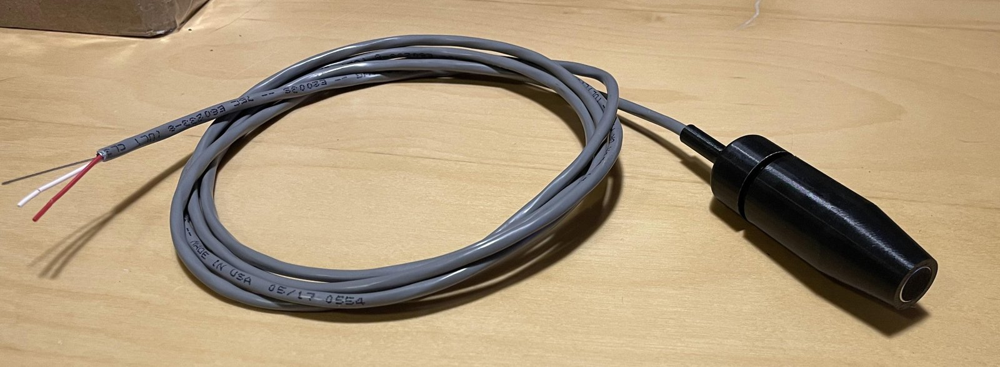
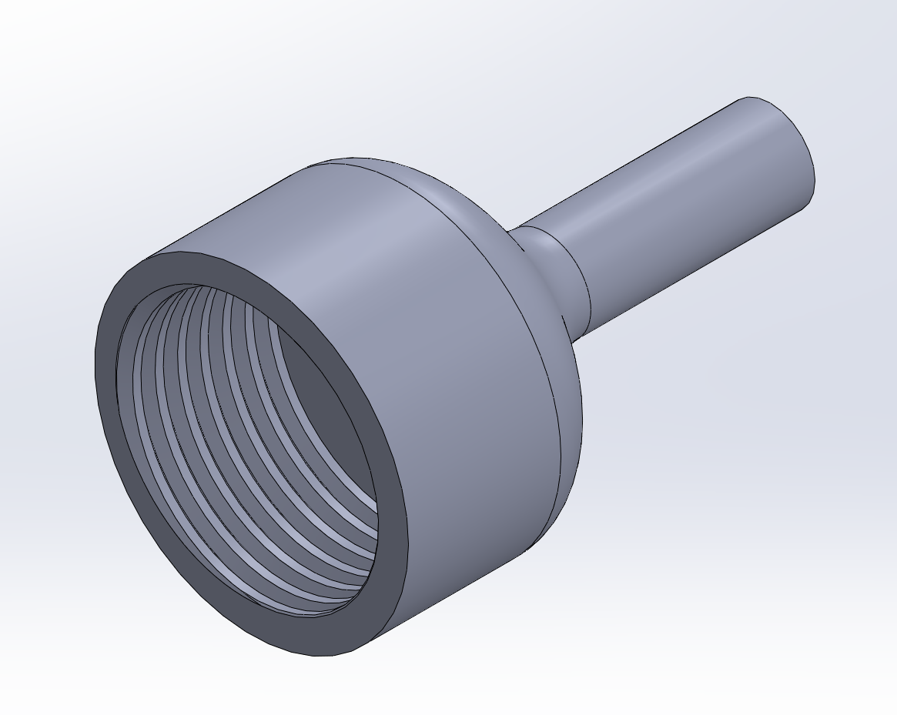
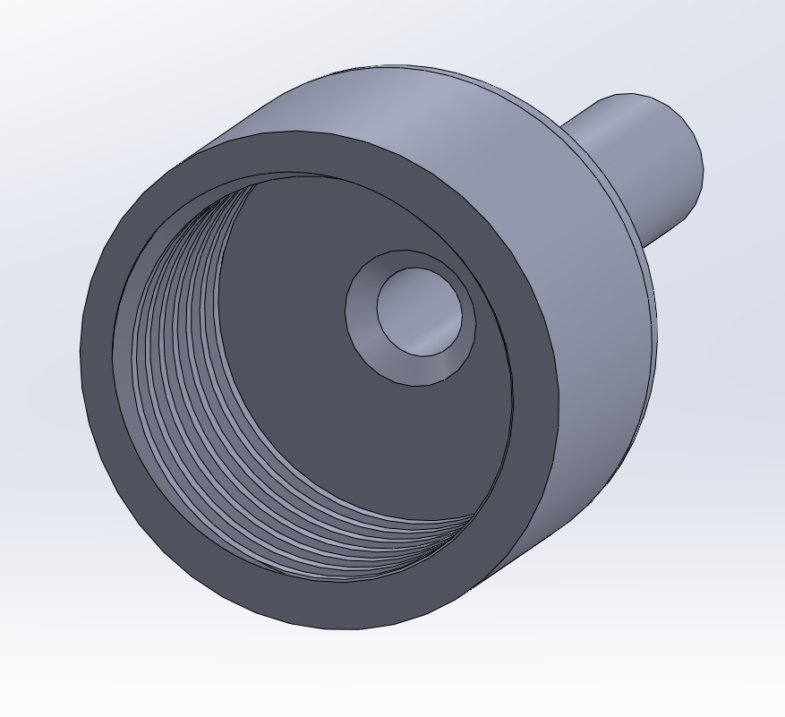
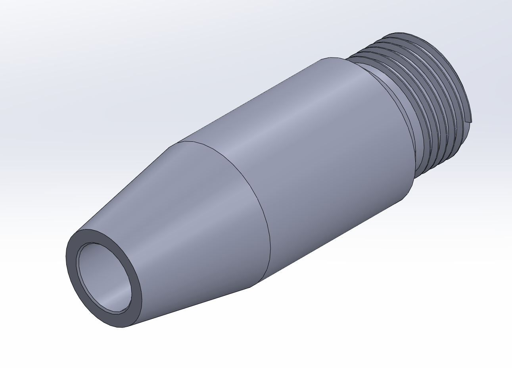
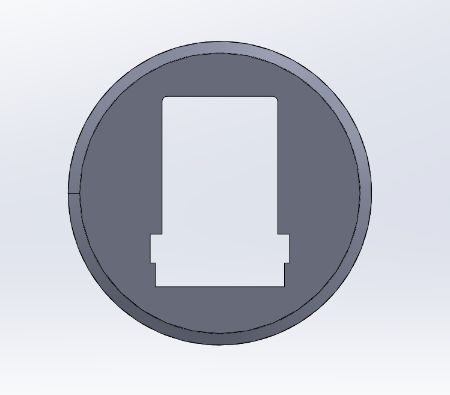
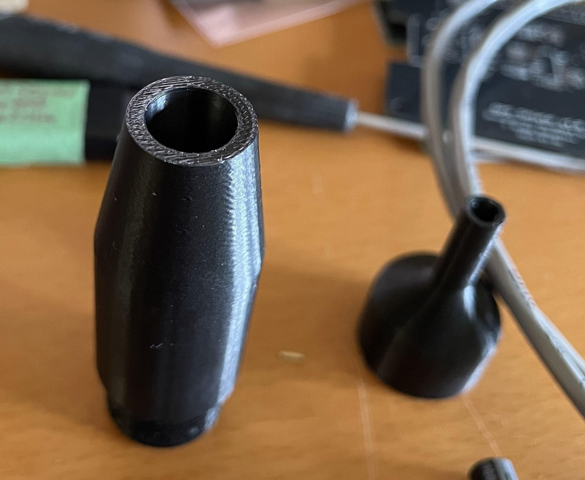
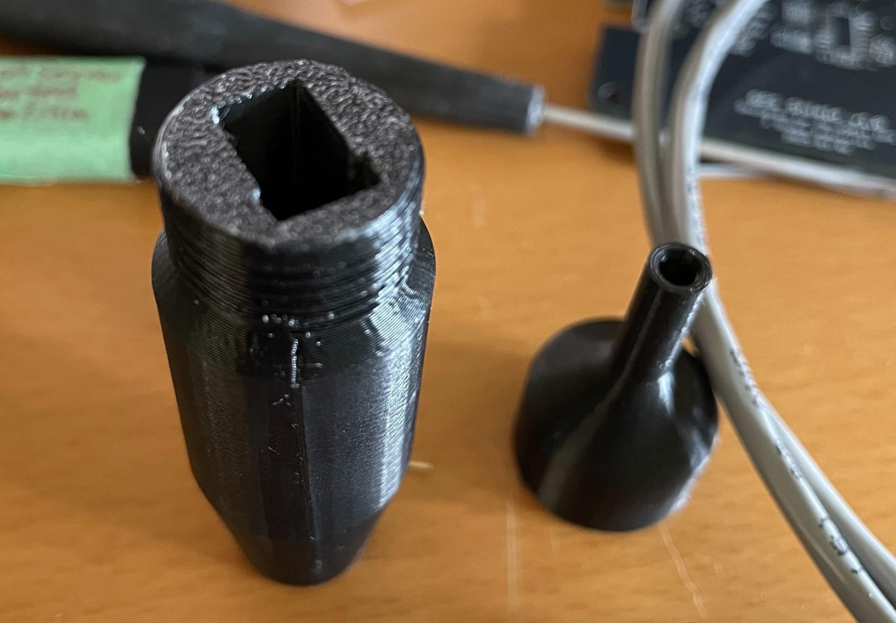
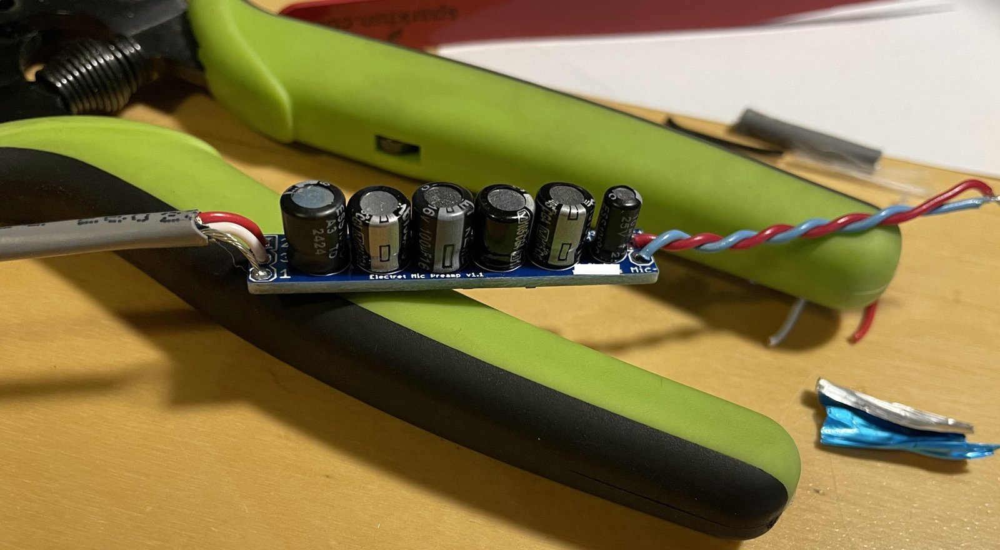
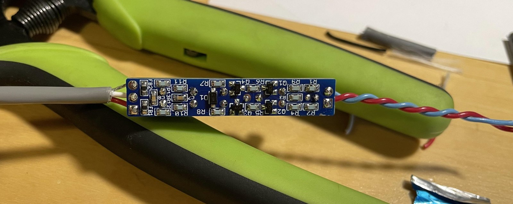

# bullet-microphone

A microphone to use outdoors for a BirdNET station, built around the [PUI Audio AOM-5024 electret capsule](./AOM-5024L-HD-F-R.pdf). 

The housing is a 3D-printed bullet with the capsule pressed into the nose, and a small preamp board inside the body.

The capsule is designed to be easily replaceable if it fails due to weather exposure.
The threaded connection and cable strain relief are waterproofed by covering with glue-filled heatshrink tubing.

It seems to work well. It has been exposed for a year to the elements and still sounds just fine. It is a lot more sensitive than I expected.

## Pre-Amp Circuit

The preamp is a discrete circuit powered by phantom power, based on [ESP Project 93](https://sound-au.com/project93.htm):

| Pin (J2) | XLR |
|---|---|
| 1 | Ground |
| 2 | Hot (signal + phantom) |
| 3 | Cold (phantom, AC-grounded) |

## PCB

The PCB is designed to be inserted into a T-shaped slot in the housing. When selecting the capacitors,
height was a consideration.

## Case

## Notes For Next Revision
- Space the electrolytic caps out a little more. They currently *just* touch, and lean slightly. Or select different capacitors.
- Label the I/O pins on both sides if there is room.

## Build

